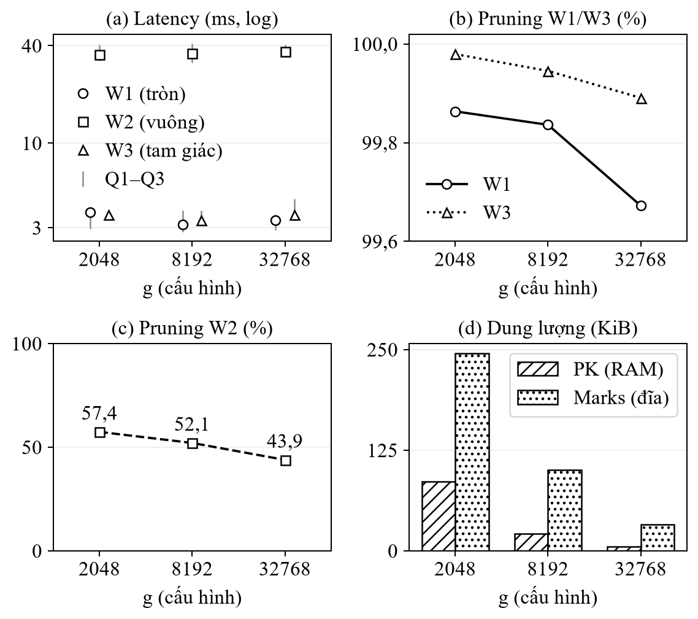

## 3.2. Dữ liệu, môi trường và phương pháp thực nghiệm

### 3.2.1. Nguồn dữ liệu và phiên bản dữ liệu nghiên cứu

#### a. Nguồn dữ liệu và khả năng truy vết

Bộ dữ liệu thực nghiệm gồm 30 tệp Parquet từ tập hits của ClickBench do ClickHouse công bố. Thứ tự shard là 0, 10, …, 90; 1, 11, …, 91; 2, 12, …, 92. Mỗi tệp có 1.000.000 dòng, tổng cộng 30.000.000 dòng gốc, không nhân bản bản ghi.

Các tệp được tải ngày 16/11/2026, với tổng dung lượng 4.711.867.682 byte. Bản kê nguồn lưu URL, thời điểm tải, dung lượng, số dòng và SHA-256 của từng tệp. SHA-256 của cả 30 tệp khớp bản kê. Schema tham chiếu được cố định tại commit ClickBench b0b7dd8f11a2a719211cc41d8c7ebbada267df66 [S12]. Thời gian tải và xác minh dữ liệu được tách khỏi thời gian đo hiệu năng.

#### b. Schema và chuyển đổi dữ liệu

Schema thực nghiệm gồm 12 cột: WatchID, UserID (Int64); CounterID, RegionID, ResponseEndTiming (Int32); AdvEngineID, IsRefresh, ResolutionWidth, ResolutionHeight, DontCountHits (Int16); EventDate (Date); EventTime (DateTime('UTC')). EventDate được chuyển theo số ngày epoch, EventTime theo số giây epoch UTC. Schema rút gọn này phục vụ nghiên cứu MergeTree, khác với schema 105 cột của benchmark ClickBench chuẩn.

Dữ liệu được chuyển từ Parquet sang RowBinary trước khi đo, giữ nguyên các bản ghi. Mỗi dòng RowBinary dài 44 byte, tương ứng 1.320.000.000 byte cho 30 tệp. Kiểm tra toàn bộ 12 cột không phát hiện NULL hoặc giá trị vượt miền kiểu đích. Số dòng và fingerprint nguồn–đích khớp ở 30/30 tệp; SHA-256 của các tệp RowBinary khớp bản kê.

#### c. Tạo mẫu hệ thống lồng nhau

Các dòng trong chuỗi 30 tệp được đánh số liên tiếp từ 0. Mẫu 1M, 3M và 10M lần lượt giữ các dòng có phần dư khi chia 30 nhỏ hơn 1, 3 và 10; tập 30M giữ toàn bộ dữ liệu. Đối chiếu ở mức byte trên 30 triệu dòng xác nhận các mẫu đúng quy tắc, lồng nhau và có số dòng tương ứng. SHA-256 của từng mẫu được lưu trong hồ sơ lấy mẫu.

Phương pháp lấy mẫu hệ thống phụ thuộc vào thứ tự tệp và có thể chịu ảnh hưởng của tính chu kỳ trong dữ liệu. Với mẫu 1M, độ lệch tỷ trọng tuyệt đối lớn nhất so với 30M là 0,001317 điểm phần trăm theo ngày, 0,000157 theo CounterID và 0,045897 theo RegionID. Việc đánh giá tính đại diện của mẫu được giới hạn ở ba thuộc tính EventDate, CounterID và RegionID.

#### d. Đặc trưng dữ liệu và bản kê dùng chung

Các quy mô 1M/3M/10M/30M đều có dữ liệu ở 17 ngày trong khoảng 02–31/07/2013. Số CounterID phân biệt lần lượt là 1.658/1.696/1.865/2.113; số RegionID phân biệt là 3.419/4.001/5.277/6.834. Hồ sơ đặc trưng dữ liệu lưu ba phân bố này và fingerprint của từng quy mô.

Bản kê dùng chung cố định thứ tự shard, schema, số dòng và SHA-256 của Parquet, RowBinary và các mẫu. Fingerprint dữ liệu gồm count(), tổng cityHash64 và XOR cityHash64 trên bộ 12 cột. Bảng thử 1M và ba bảng E2 chính thức 30M đều khớp fingerprint của dữ liệu đầu vào tương ứng. Phép kiểm tra bằng hàm băm chịu giới hạn về khả năng va chạm. Toàn bộ bước chuẩn bị và kiểm tra dữ liệu được thực hiện ngoài thời gian đo truy vấn.

### 3.2.2. Môi trường và các biến giữ cố định

Thực nghiệm E2 sử dụng ClickHouse trên Ubuntu trong môi trường WSL2, với cấu hình phần cứng và phần mềm cố định.

*Bảng 3.1. Môi trường thực nghiệm E2.*

| Thành phần | Cấu hình |
| --- | --- |
| Bộ xử lý | Intel Xeon E-2176M, 2,70 GHz; 6 nhân, 12 luồng. |
| Tài nguyên WSL2 | 12 CPU logic; 15,38 GiB RAM; không có tệp .wslconfig tùy chỉnh tại đường dẫn mặc định. |
| Hệ điều hành | Windows 11 Pro for Workstations; Ubuntu 26.04.1 LTS qua WSL2. |
| Kernel | 6.18.58.1-microsoft-standard-WSL2. |
| Phần mềm | Python 3.14.4; ClickHouse server, client và local 26.10.3.7. |
| Lưu trữ | SSD NVMe INTEL SSDPEKKF512G8L 512 GB. Dữ liệu và ClickHouse nằm trên hệ thống tệp Linux; VHDX Ubuntu nằm trên ổ C. |
| Dung lượng trống | Dung lượng trống của ổ C chứa VHDX tại thời điểm ghi nhận: 125.223.747.584 byte. |
| ClickHouse | Instance ClickHouse dành riêng cho thí nghiệm, có cấu hình và thư mục dữ liệu độc lập; chỉ lắng nghe trên localhost. |

Ba bảng E2 có cùng dữ liệu và cấu hình; chỉ index_granularity thay đổi giữa 2.048, 8.192 và 32.768 dòng.

*Bảng 3.2. Các thiết lập giữ cố định trong E2.*

| Thành phần | Thiết lập |
| --- | --- |
| Engine, schema và codec | MergeTree; 12 cột; CODEC(LZ4) cho tất cả các cột. |
| Khóa sắp xếp | ORDER BY (CounterID, EventDate); PRIMARY KEY mặc định theo sorting key [S2]. |
| Cấu trúc bảng | Một part đang hoạt động, định dạng Wide; không khai báo PARTITION BY, materialized view, projection hoặc skip index. |
| Giới hạn tài nguyên | max_threads=4; max_insert_threads=1; max_memory_usage=2.000.000.000 byte. |
| Granule và marks | index_granularity_bytes=0; write_final_mark=0. |
| Nạp dữ liệu | async_insert=0; fsync_after_insert=1. |
| Bộ nhớ đệm | Tắt query cache và query condition cache. |
| Tối ưu truy vấn | Tắt skip index, PREWHERE tự động, trivial count và read/aggregation-in-order. |

Cấu hình truy vấn tuân theo protocol mergetree-v2. Tệp effective_settings.json lưu 20 thiết lập có hiệu lực của lần đo E2; các giá trị khớp protocol. DDL thực tế được lưu bằng SHOW CREATE TABLE, trong đó write_final_mark=0 được giữ để truy vết cấu hình. Trong ClickHouse 26.10.3.7, write_final_mark là thiết lập lỗi thời, không còn tác dụng [SFM]. PRIMARY KEY của MergeTree cho phép các bản ghi trùng giá trị khóa [S2].

Quy trình E1/E2 sử dụng OPTIMIZE TABLE … FINAL trong giai đoạn chuẩn bị để hợp nhất bảng về một part đang hoạt động, định dạng Wide. Thời gian hợp nhất và chờ ổn định được ghi riêng, ngoài thời gian đo truy vấn. Bảng thử 1M với g8192 (index_granularity=8192) có 123 marks và fingerprint khớp dữ liệu đầu vào. Trong ba lần quan sát cách nhau khoảng 10 giây, part giữ nguyên và không có merge hoặc mutation.

Ba bảng E2 chính thức 30M đều có một part đang hoạt động, định dạng Wide, trước và sau đo. Kết quả được trình bày tại mục 3.4. Quy trình E3 giữ merge nền tự nhiên, không sử dụng OPTIMIZE FINAL hoặc STOP MERGES. Các số liệu nạp trong phần phương pháp thuộc thử nghiệm kiểm tra công cụ thu thập chỉ số, tách biệt với kết quả E3 chính thức.

### 3.2.3. Bộ truy vấn và các chỉ số đo lường

Bộ truy vấn gồm năm workload W0–W4, cùng sử dụng SELECT count(), sum(ResolutionWidth). W0 không lọc, W1 lọc CounterID=3258 và W2 lọc EventDate thuộc [2013-07-15, 2013-07-23). W3 kết hợp điều kiện của W1 và W2. W4 lọc RegionID=229, là cột ngoài khóa sắp xếp.

Thử nghiệm sơ bộ (pilot) trên 1M dòng cho thấy các giá trị lọc ban đầu khiến W3 và W4 không có bản ghi thỏa điều kiện. Trước lần chạy chính thức, protocol mergetree-v2 mở rộng cận trên ngày đến 23/07/2013 và chọn RegionID=229 theo phân bố dữ liệu, độc lập với thời gian truy vấn. Số bản ghi thỏa điều kiện của W0–W4 trên pilot lần lượt là 1.000.000, 1.294, 382.135, 134 và 205.725. Các giá trị lọc này được giữ thống nhất giữa các cấu hình và quy mô.

Thời gian client_ms được đo từ lúc gửi yêu cầu HTTP đến khi nhận đầy đủ phản hồi. Các chỉ số query_duration_ms, read_rows, read_bytes và memory_usage được lấy từ sự kiện QueryFinish theo query_id [S10]. EXPLAIN ESTIMATE cung cấp số dòng, marks và parts ước tính cần đọc; tổng số marks lấy từ system.parts, kèm kế hoạch EXPLAIN indexes=1 [S7]. Tỷ lệ loại bỏ granule được tính bằng pruning=1−selected_marks/total_marks. Báo cáo phân biệt số bản ghi thỏa điều kiện, số dòng đọc thực tế và số dòng ước tính.

Dung lượng được tổng hợp từ system.parts với active=1 qua các trường bytes_on_disk, data_compressed_bytes, data_uncompressed_bytes, marks_bytes và primary_key_bytes_in_memory [S6]. Trong đó, bytes_on_disk là dung lượng các part đang hoạt động, marks_bytes là dung lượng marks trên đĩa và primary_key_bytes_in_memory là bộ nhớ chứa giá trị khóa chính. Chỉ số read_bytes đo lượng đọc logic do ClickHouse ghi nhận, khác với lượng I/O vật lý của SSD.

Phép đo nạp lưu từng lô và query_id, với throughput=N/ingest_ack_s. Thời gian ingest_ack_s tính từ lần gửi đầu đến phản hồi hoàn tất (ACK) cuối, bao gồm xử lý cục bộ giữa các lô. Snapshot dung lượng và số part được lấy sau ACK cuối và sau khi đạt điều kiện ổn định. Hai snapshot phản ánh thời điểm lấy mẫu, không phải trạng thái nguyên tử tại ACK. Các sự kiện NewPart và MergeParts được đối chiếu theo table_uuid. Pilot 1M gồm 10 lô × 100.000 dòng, tạo 10 NewPart, một MergeParts và năm part đang hoạt động ở cả hai snapshot. Tổng duration và read_rows của merge được tính riêng với thời gian ACK, thời gian chờ và CPU time.

### 3.2.4. Quy trình lặp, tính đúng đắn và tái lập

Quy trình E1/E2 quy định hai lượt khởi động (warmup) và 10 lượt đo cho mỗi tổ hợp. Thứ tự thực hiện được đảo bằng seed 20261116. Ma trận E2 gồm 3 cấu hình × 5 workload, tương ứng 30 warmup và 150 lượt đo chính thức. Kết quả count() và sum() được kiểm tra riêng; các lượt đo sử dụng FORMAT Null. Nhật ký lưu toàn bộ query_id, số đo, lỗi và timeout, kể cả các giá trị ngoại lệ. Đối với E3, protocol quy định ba vòng cho mỗi kích thước lô, thực hiện theo thứ tự luân phiên.

Kết quả được tổng hợp bằng trung vị và các tứ phân vị theo phương pháp inclusive. Q1 và Q3 lần lượt là phân vị 25% và 75%, với IQR=Q3−Q1. Khoảng Q1–Q3 biểu thị độ phân tán của phần giữa phân bố; khoảng tin cậy của trung vị chưa được ước lượng. Với 10 lượt đo mỗi tổ hợp, p95 không được dùng làm căn cứ kết luận chính.
Điều kiện ổn định gồm ba quan sát cách nhau 10 giây, part giữ nguyên và không có merge hoặc mutation, với thời gian chờ tối đa 1.200 giây. Cửa sổ xác nhận tối thiểu 20 giây phản ánh trạng thái quan sát, tách biệt với thời gian xử lý merge và trạng thái hệ thống sau đó. Bộ nhớ đệm hệ điều hành không được xóa; các phép đo sử dụng chế độ lặp sau warmup (warm-repeat).

Trước mỗi truy vấn E2, chương trình kiểm tra merge, mutation chưa hoàn tất và các truy vấn khác trên instance nghiên cứu. Phạm vi kiểm soát này không bao gồm ứng dụng nền trong Windows hoặc WSL2. Các phép đối chứng và tỷ số thời gian được tính trong cùng máy, quy mô, workload và protocol. Lần chạy E2 chính thức được tạo sau khi kết thúc pilot, với mã nguồn và cấu hình lưu trong hồ sơ tái lập.

Hồ sơ E2 gồm số đo gốc, QueryFinish, DDL, SQL, EXPLAIN, snapshot dung lượng và hình. Các tệp dữ liệu, định danh lần chạy và mốc mã nguồn được tổng hợp trong bảng hồ sơ tái lập. Việc tái lập ít nhất một cặp đối chứng trên máy thứ hai bởi người rà soát độc lập chưa được thực hiện; yêu cầu này của T32-15 vẫn chưa hoàn tất.

*Bảng 3.3. Hồ sơ tái lập E2.*

| Thành phần | Định danh hoặc vị trí lưu |
| --- | --- |
| Bản kê nguồn | [manifests/hits30m.sources.json](https://github.com/w1ndS0ng/clickhouse-mergetree-study/blob/79da3d57e729e08e0aba059671726ebed5ec7f86/manifests/hits30m.sources.json) |
| Kiểm tra schema | [manifests/hits30m.schema-audit.json](https://github.com/w1ndS0ng/clickhouse-mergetree-study/blob/79da3d57e729e08e0aba059671726ebed5ec7f86/manifests/hits30m.schema-audit.json) |
| Kiểm tra mẫu | [manifests/hits30m.sampling-audit.json](https://github.com/w1ndS0ng/clickhouse-mergetree-study/blob/79da3d57e729e08e0aba059671726ebed5ec7f86/manifests/hits30m.sampling-audit.json) |
| Đặc trưng dữ liệu | [manifests/hits30m.profile.json](https://github.com/w1ndS0ng/clickhouse-mergetree-study/blob/79da3d57e729e08e0aba059671726ebed5ec7f86/manifests/hits30m.profile.json) |
| Bản kê dùng chung | [manifests/hits30m.lock.json](https://github.com/w1ndS0ng/clickhouse-mergetree-study/blob/79da3d57e729e08e0aba059671726ebed5ec7f86/manifests/hits30m.lock.json) |
| Lần chạy chính thức / pilot | e2main_v2_20261117 / e2pilot_v2_20261117 |
| Mã đo / mã xuất hình | 2e65b9d / c47338a |
| Metadata tái lập | protocol hash, manifest hash, trạng thái Git; lưu theo member/machine/run |
| Hồ sơ E2 | [artifacts/tuan/wsl_xeon/e2main_v2_20261117/](https://github.com/w1ndS0ng/clickhouse-mergetree-study/tree/79da3d57e729e08e0aba059671726ebed5ec7f86/artifacts/tuan/wsl_xeon/e2main_v2_20261117/) |
| Gói nhật ký cục bộ | results/tuan/wsl_xeon/e2main_v2_20261117/share_results_figure31_v5.zip |

Bảng 3.4. Thiết lập và ma trận thực nghiệm E2.

| Thành phần | Thiết lập E2 |
| --- | --- |
| Dữ liệu | Bộ dữ liệu đã khóa: 30M dòng, 12 cột; các biến thể khớp fingerprint và đáp án. |
| Bảng và khóa | MergeTree; K1 (CounterID, EventDate); LZ4; một active Wide part. |
| Biến đối chứng | g=2048/8192/32768; index_granularity_bytes=0; write_final_mark=0. |
| Tài nguyên | ClickHouse 26.10.3.7; max_threads=4; max_insert_threads=1; giới hạn bộ nhớ 2.000.000.000 byte. |
| Ma trận đo | 3 cấu hình g × 5 workload × 10 lượt = 150 lượt chính; 2 warmup/tổ hợp; seed 20261116. |

Quy trình E2 gồm cố định dữ liệu, chạy pilot 1M, tạo lần chạy chính thức, nạp và chuẩn hóa part, kiểm tra fingerprint và đáp án, thực hiện warmup và đo, sau đó tổng hợp kết quả.

## 3.4. E2 — Index granularity: thiết kế, kết quả và chi phí chỉ mục

### 3.4.1. Cấu hình và kiểm chứng đối chứng

E2 so sánh ba mức index_granularity=2048/8192/32768 theo cấu hình ở Bảng 3.4, lấy g8192 làm mốc đối chứng trên cùng máy. Khóa K1 (CounterID, EventDate), dữ liệu 30M dòng với 12 cột, LZ4 và một part đang hoạt động định dạng Wide được giữ cố định. Pilot 1M được thực hiện trong lần chạy riêng trước thực nghiệm chính thức 30M. Ba bảng có count/hash_sum/hash_xor khớp dữ liệu đầu vào và cùng đáp án count(), sum(ResolutionWidth) cho W0–W4. Số bản ghi thỏa điều kiện lần lượt là 30.000.000, 38.841, 11.464.429, 4.012 và 6.185.519. Hồ sơ lưu DDL thực tế và EXPLAIN của 15 tổ hợp.

### 3.4.2. Chạy đo và kiểm tra công thức

Lần chạy chính thức gồm 150 lượt đo và 30 warmup, với 10 số đo cho mỗi tổ hợp. Toàn bộ 150/150 query_id khớp QueryFinish; nhật ký không ghi nhận lỗi truy vấn. Trạng thái part và fingerprint sau đo khớp trước đo. Snapshot dung lượng được lấy sau khi đạt điều kiện ổn định. Thời gian OPTIMIZE chuẩn bị của g2048/g8192/g32768 lần lượt là 7.983,681/7.514,693/7.245,069 ms, tách khỏi thời gian truy vấn.

Với N=30.000.000, một part và granularity cố định (index_granularity_bytes=0), công thức M_est=ceil(N/g) cho 14.649/3.663/916 marks, bằng số thực tế. Bộ giá trị khóa Int32+Date rộng 6 byte, nên I_key_est=M_est×6 cho 87.894/21.978/5.496 byte, khớp primary_key_bytes_in_memory ở cả ba bảng. Mô hình tính phần bộ nhớ chứa giá trị khóa, chưa gồm marks của các cột, metadata và bộ nhớ dự phòng do cấp phát. Công thức R_est≈min(N, selected_marks×g) ước tính lượng dòng đọc, với sai lệch có thể phát sinh ở granule cuối ngắn hơn g dòng.

### 3.4.3. Kết quả loại bỏ granule, thời gian truy vấn và dung lượng chỉ mục

Bảng 3.5. Kết quả E2 trên 30M dòng, máy wsl_xeon, protocol mergetree-v2. Mỗi ô lần lượt ghi read_rows; selected/total marks; pruning (%); trung vị client_ms/IQR (ms), với 10 lượt đo mỗi tổ hợp. read_rows là trung vị; marks lấy từ EXPLAIN và system.parts.

| Case | g2048 | g8192 | g32768 |
| --- | --- | --- | --- |
| W0 | 30.000.000 14.649/14.649 0,000% 34,776 / 12,937 | 30.000.000 3.663/3.663 0,000% 38,757 / 13,210 | 30.000.000 916/916 0,000% 33,449 / 6,590 |
| W1 | 40.960 20/14.649 99,863% 3,750 / 1,002 | 49.152 6/3.663 99,836% 3,149 / 1,000 | 98.304 3/916 99,672% 3,342 / 0,709 |
| W2 | 12.780.416 6.241/14.649 57,396% 35,083 / 8,434 | 14.377.856 1.756/3.663 52,061% 35,850 / 9,918 | 16.827.264 514/916 43,886% 36,704 / 6,435 |
| W3 | 6.144 3/14.649 99,980% 3,598 / 0,192 | 16.384 2/3.663 99,945% 3,347 / 0,627 | 32.768 1/916 99,891% 3,613 / 1,220 |
| W4 | 30.000.000 14.649/14.649 0,000% 86,235 / 19,474 | 30.000.000 3.663/3.663 0,000% 87,399 / 13,883 | 30.000.000 916/916 0,000% 79,283 / 24,830 |

Bảng 3.6. Dung lượng dữ liệu và chỉ mục trong E2, N=30M, một Wide part. Primary index thực tế là primary_key_bytes_in_memory; cặp số ghi ước tính/thực tế; MiB=2²⁰ byte.

| g | Marks ước tính / thực tế | Primary index ước tính / thực tế (byte) | marks_bytes (byte) | Cặp dung lượng (MiB): dữ liệu nén; tổng bảng đang hoạt động |
| --- | --- | --- | --- | --- |
| 2048 | 14.649 / 14.649 | 87.894 / 87.894 | 251.092 | 498,164 / 498,408 |
| 8192 | 3.663 / 3.663 | 21.978 / 21.978 | 103.008 | 498,103 / 498,204 |
| 32768 | 916 / 916 | 5.496 / 5.496 | 33.161 | 488,362 / 488,396 |

Hình 3.1. Kết quả E2 trên máy wsl_xeon; N=30M, n=10. (a) Trung vị client_ms và khoảng Q1–Q3 (nét xám), trục log; các điểm được dịch ngang để tránh chồng lấp. (b–c) Pruning (%), ô (b) phóng đại từ 99,6%. (d) Primary index (RAM) và marks (đĩa), KiB=2¹⁰ byte.

### 3.4.4. Phân tích điểm cân bằng

So với g8192, g2048 giảm read_rows khoảng 16,7% ở W1, 11,1% ở W2 và 62,5% ở W3 (Bảng 3.5). Bộ nhớ chứa giá trị khóa chính tăng gần 4 lần, còn marks_bytes tăng 2,44 lần. Trung vị client_ms của W1/W3 tăng từ 3,149/3,347 lên 3,750/3,598 ms, trong khi W2 giảm từ 35,850 xuống 35,083 ms. Mức giảm lượng đọc vì vậy chưa chuyển thành mức cải thiện thời gian tương ứng trong lần đo này. Ảnh hưởng riêng của chi phí xử lý, bộ nhớ đệm và biến động thực thi chưa được tách trong thiết kế.

W0 và W4 đọc toàn bộ 30M dòng, với pruning bằng 0 ở cả ba cấu hình. Cấu hình g32768 giảm dung lượng primary index và marks nhưng tăng lượng đọc ở W1–W3. Dung lượng dữ liệu nén ở Bảng 3.6 cũng thay đổi theo g, nên chênh lệch bytes_on_disk phản ánh cả phần dữ liệu và các cấu trúc phụ trợ.
Cấu hình g8192 có trung vị client_ms thấp nhất ở W1 và W3 trong lần đo này. Các khoảng Q1–Q3 giữa các cấu hình chồng lấp trên Hình 3.1(a); khác biệt thời gian chưa được đánh giá bằng kiểm định thống kê. Kết quả thể hiện đánh đổi giữa lượng đọc, thời gian truy vấn và dung lượng chỉ mục trong cấu hình K1, LZ4, một Wide part, index_granularity_bytes=0 và chế độ warm-repeat trên máy đã đo. Phạm vi thực nghiệm chưa xác định một giá trị g tối ưu cho mọi workload.

[S2]: https://clickhouse.com/docs/reference/engines/table-engines/mergetree-family/mergetree
[S6]: https://clickhouse.com/docs/reference/system-tables/parts
[S7]: https://clickhouse.com/docs/reference/statements/explain
[S10]: https://clickhouse.com/docs/reference/system-tables/query_log
[S12]: https://github.com/ClickHouse/ClickBench/blob/b0b7dd8f11a2a719211cc41d8c7ebbada267df66/clickhouse/create.sql
[SFM]: https://github.com/ClickHouse/ClickHouse/blob/v26.10.3.7-stable/src/Storages/MergeTree/MergeTreeSettings.cpp#L2701-L2714
